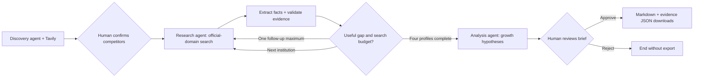

# Bank & Credit Union Growth Intelligence Agent

A focused Project A submission: compare a bank or credit union's checking product with three confirmed competitors and review three growth experiments supported by public-source evidence.

**Demo institution:** Truliant Federal Credit Union. **Market:** Charlotte, North Carolina. **Product:** consumer checking accounts.

## Run it

Python 3.12 is the tested runtime. From this folder:

```powershell
python -m venv .venv
.\.venv\Scripts\python.exe -m pip install -r requirements.txt
.\.venv\Scripts\python.exe -m streamlit run app.py
```

If dependencies are already installed, run `python -m streamlit run app.py` or `./run.ps1`. On macOS/Linux, use `.venv/bin/python` in place of `.venv/Scripts/python.exe`.

The default **Recorded evidence demo** needs no credentials. Click **Discover competitors**, **Confirm and research**, inspect the comparison/evidence/trace, acknowledge review, then **Approve and enable downloads**. The optional Skyla outage demonstrates a failed search, one retry, and explicit unknowns. No new API calls or LLM decisions occur in recorded mode; curated outputs exercise the same graph, grounding and approval logic.

## Enable live research

Copy `.env.example` to `.env` in this folder and set:

```dotenv
TAVILY_API_KEY=your-local-key
OPENAI_API_KEY=your-local-model-provider-key
MODEL_NAME=gpt-4.1-mini
OPENAI_BASE_URL=
```

Never paste keys into chat, screenshots, GitHub or the project document. `.env` is ignored by Git and excluded from the submission ZIP. Model availability depends on your provider/account. For a compatible cohort endpoint, set `OPENAI_BASE_URL`, use its key in `OPENAI_API_KEY`, and set `MODEL_NAME` to the provider's exact model ID. Support depends on a compatible chat-completions API returning JSON as prompted; test it before recording. Empty `OPENAI_BASE_URL` uses the model client's default endpoint. No extra model call to a cohort provider is mandatory in the supplied handout (“may use”).

Choose **Live research** before starting, enter a home institution/domain/market, and discover candidates. Confirm or replace all three names and official domains. A failed discovery permits manual selection. Read-only search is autonomous after confirmation; downloads remain locked until final approval.

Streamlit's built-in table CSV/clipboard export controls are disabled; use the approved briefing/evidence downloads. Approval is a workflow control, not a data-secrecy boundary: drafts are visible for review and can still be read or captured.

## Architecture



- **Discovery agent:** proposes three plausible local alternatives and their official domains. Candidates are not an independently verified “top three” ranking.
- **Research agent:** extracts one mainstream checking product per institution; chooses a targeted follow-up query when evidence is incomplete. Opening deposit, ongoing balance and fee-waiver balance are separate fields.
- **Analysis agent:** proposes three hypotheses, experiments and metrics using source IDs attached to supported facts. Hypotheses are inference, not established growth outcomes.
- **Orchestrator:** LangGraph `StateGraph` with conditional routing, `InMemorySaver`, native `interrupt()` gates and `Command(resume=...)`.

## State, limits and recovery

State holds the request, confirmed competitors, sources, grounded profiles, gaps, active institution/round, hypotheses, warnings, trace and approval. It survives Streamlit reruns in the active browser session. It is intentionally in memory: browser-session loss or process restart loses the run. Export approved files to retain them. There is no persistent customer memory or external database.

Each institution gets up to two searches, five results per search, and one retry per remote operation. A full run makes at most nine logical searches (one discovery plus eight research) and ten logical model operations (one discovery, eight extractions, one analysis), each with at most two attempts. Search timeout is 20 seconds; model timeout is 35 seconds. Exhausted search/extraction failures produce explicit unknowns. Exhausted analysis failures produce a partial comparison and a warning, never an offline result silently substituted into live mode. Latency and costs vary; live performance is not guaranteed.

Grounding checks enforce: known source ID, matching confirmed official domain, exact normalized quote match, and numeric values present in the quote. This is a lexical check; it does not prove semantic entailment, freshness or full disclosure coverage. Search snippets can omit conditions, offers and dates. Human reviewers should check the full official pages. The app does not certify compliance or execute campaigns.

## Test and reproduce

```powershell
python -m unittest discover -s tests -v
python -m growth.cli --demo --approve-demo
```

The CLI generates a labeled, scripted demo export under `samples/`. It is not a real human approval or a live API evaluation. Tests use the real graph and Streamlit AppTest; only external HTTP/model boundaries use fixtures or test doubles. See `docs/verification.md` for observed results and limits.

## Submission assets

- `docs/project-documentation.md`: copy-ready project narrative, decisions, data provenance and learnings.
- `docs/demo-script.md`: under-five-minute recording outline.
- `docs/submission-checklist.md`: remaining submission steps and URLs.
- `samples/`: sample briefing and evidence JSON, clearly labeled by execution mode.
- `docs/design.md`, `docs/implementation-plan.md`, `docs/build-ledger.md`: design and development record.

## Source provenance and original work

Recorded evidence is a small curated set of official product-page excerpts collected October 24, 2026. See `data/demo.json` for URLs and collection notes. Competitor selection in this replay is illustrative and user-confirmed, not a market-share analysis. Full disclosures and all eligibility/offer terms were not captured. The live system uses Tavily; the recorded fixture was collected during development with web research and is not a stored Tavily response.

Built for this project from its requirements. The handout's supplied solution documents were not consulted. AI coding tools assisted with design, implementation, testing and documentation; see the prompt/iteration log in the project document. Review the final submission and add your own observations before presenting it as your work.
