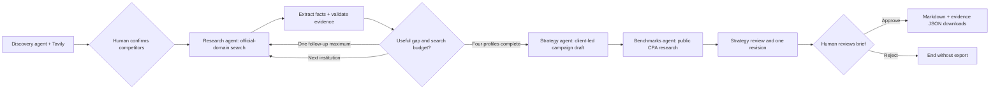

# Bank & Credit Union Growth Intelligence Agent

A focused Project A submission: compare a bank or credit union's checking product with three confirmed competitors and review three client-needs-led campaign concepts, public CPA research, one strategy review/revision and session-local API usage/cost tracking.

**Demo institution:** Truliant Federal Credit Union. **Market:** Charlotte, North Carolina. **Product:** consumer checking accounts.

**Public app:** https://bank-cu-growth-intelligence.streamlit.app/ · Recorded demo requires no keys; live research uses each visitor's OpenAI and Tavily keys.

## Run it

Python 3.12 is the tested runtime. From this folder:

```powershell
python -m venv .venv
.\.venv\Scripts\python.exe -m pip install -r requirements.txt
.\.venv\Scripts\python.exe -m streamlit run app.py
```

If dependencies are already installed, run `python -m streamlit run app.py` or `./run.ps1`. On macOS/Linux, use `.venv/bin/python` in place of `.venv/Scripts/python.exe`.

The default **Recorded evidence demo** needs no credentials. Click **Explore recorded demo**, **Confirm and research**, inspect the comparison/evidence/trace, acknowledge review, then **Approve and enable downloads**. The optional Skyla outage demonstrates a failed search, one retry, and explicit unknowns. No new API calls or LLM decisions occur in recorded mode; curated outputs exercise the same graph, grounding and approval logic.

## Enable live research

Enter your own OpenAI and Tavily API keys in the password-masked research-panel inputs. Select an available OpenAI model under **Model settings** (default `gpt-6-luna`, used in the Charlotte live test). The web app does not load `.env`, process environment keys, or Streamlit secrets. The OpenAI API endpoint is fixed; a visitor cannot redirect keys to another endpoint.

Keys travel to the app server and remain in that visitor's session memory and provider clients. They are not intentionally written to disk, reports, URLs or logs; no shared graph or credential cache is used. **Clear keys & session** clears inputs and discards the active graph, provider references and report. Closing a tab does not guarantee immediate memory cleanup. Use HTTPS when hosting and do not paste keys into chat or screenshots. Provider usage is charged to the visitor's account. Existing local `.env` files remain ignored and excluded from deployment bundles.

For GPT-5/GPT-6 and o-series reasoning model names, the client omits explicit temperature settings to avoid unsupported sampling parameters.

Choose **Live research** at the top of the main workspace, enter the FI name and market, click **Find official website**, inspect/correct the suggestion, and explicitly confirm the FI and website before starting competitor discovery. Confirm or replace all three names and official domains. A failed discovery permits manual selection. Read-only search is autonomous after confirmation; downloads remain locked until final approval.

Streamlit's built-in table CSV/clipboard export controls are disabled; use the approved briefing/evidence downloads. Approval is a workflow control, not a data-secrecy boundary: drafts are visible for review and can still be read or captured.

## Public deployment

See [deployment instructions](docs/public-deployment.md). Option 3 from the Figma concepts is implemented with the existing responsive Streamlit layout: blue-gray canvas, cobalt actions, navy research panel, summary metrics and three opportunity cards. The mockup's static desktop positioning is adapted to native widgets and mobile stacking.

## Architecture



- **Discovery agent:** proposes three plausible local alternatives and their official domains. Candidates are not an independently verified “top three” ranking.
- **Research agent:** extracts one mainstream checking product per institution; chooses a targeted follow-up query when evidence is incomplete. Opening deposit, ongoing balance and fee-waiver balance are separate fields.
- **Strategy agent:** proposes three campaign concepts with audience, client-need connection, message, allowed channels, experiment, outcome and guardrail. After benchmark research it critiques the draft and revises once. The original and review findings remain inspectable.
- **Benchmarks agent:** researches public checking account acquisition CPA evidence, retaining exact source quotes, account definitions, period, cost coverage and comparability. Missing CPA remains unknown; public results are not forecasts or rate cards.
- **Orchestrator:** LangGraph `StateGraph` with conditional routing, `InMemorySaver`, native `interrupt()` gates and `Command(resume=...)`.

## State, limits and recovery

State holds the request, confirmed competitors, sources, grounded profiles, gaps, active institution/round, hypotheses, warnings, trace and approval. It survives Streamlit reruns in the active browser session. It is intentionally in memory: browser-session loss or process restart loses the run. Export approved files to retain them. There is no persistent customer memory or external database.

Each institution gets up to two searches, five results per search, and one retry per remote operation. A full run makes at most ten logical searches (one discovery, eight research and one benchmark) and thirteen logical model operations (one discovery, eight extractions, one strategy draft, one benchmark extraction, one critique and one revision), each with at most two attempts. Search timeout is 20 seconds; model timeout is 35 seconds. Exhausted search/extraction failures produce explicit unknowns. Exhausted analysis failures produce a partial comparison and a warning, never an offline result silently substituted into live mode. Latency and costs vary; live performance is not guaranteed.

Grounding checks enforce: known source ID, matching confirmed official domain, exact normalized quote match, and numeric values present in the quote. Explicitly uncertain or ambiguous claims remain unverified. Product identity must be source-supported before an institution can supply comparison terms. Tavily requests cleaned full-page text, retaining up to 14,000 characters per source with a search-excerpt fallback. This is still a lexical check; it does not prove semantic entailment, freshness or full disclosure coverage. Collected text can omit conditions, offers and dates. Human reviewers should check the full official pages. The app does not certify compliance or execute campaigns.

## Test and reproduce

```powershell
python -m unittest discover -s tests -v
python -m growth.cli --demo --approve-demo
```

The CLI generates a labeled, scripted demo export under `samples/`. It is not a real human approval or a live API evaluation. Tests use the real graph and Streamlit AppTest; only external HTTP/model boundaries use fixtures or test doubles. See `docs/verification.md` for observed results and limits.

## Submission assets

- `docs/project-documentation.md`: copy-ready project narrative, decisions, data provenance and learnings.
- `docs/demo-script.md`: under-five-minute recording outline.
- `docs/submission-checklist.md`: remaining submission steps and URLs.
- `samples/`: sample briefing and evidence JSON, clearly labeled by execution mode.
- `docs/design.md`, `docs/implementation-plan.md`, `docs/build-ledger.md`: design and development record.

## Source provenance and original work

Recorded evidence is a small curated set of official product-page excerpts collected October 24, 2026. See `data/demo.json` for URLs and collection notes. Competitor selection in this replay is illustrative and user-confirmed, not a market-share analysis. Full disclosures and all eligibility/offer terms were not captured. The live system uses Tavily; the recorded fixture was collected during development with web research and is not a stored Tavily response.

Built for this project from its requirements. The handout's supplied solution documents were not consulted. AI coding tools assisted with design, implementation, testing and documentation; see the prompt/iteration log in the project document. Review the final submission and add your own observations before presenting it as your work.

## Review, revision and usage visibility

The UI has Comparison & opportunities, Evidence & gaps, Benchmarks, Review & revision, Agent activity & costs, and How it works tabs. The Strategy agent performs review/revision; there is no fifth agent. Invalid revision references or exhausted review/revision failures retain the original draft and display warnings. One revision cycle can make up to two HTTP attempts; no unbounded reflection loop runs. An accepted revision does not certify that every review concern was resolved.

Provider calls are orchestrated Python calls. Models return structured decisions; this is not an autonomous function-calling tool loop. The activity panel distinguishes workflow operations from actual provider attempts. Demo activity is local replay with zero external calls and no fabricated usage.

OpenAI response usage is captured before JSON parsing, including responses requiring retries. Records include role, action, attempt, model, timing, input/output/total tokens, cache reads and reasoning tokens when available, plus separate input/output cost estimates. Cached tokens are a subset of input and reasoning tokens a subset of output. Missing provider usage and unmatched pricing remain unknown, with partial totals explicitly identified. Model pricing is a dated standard-text snapshot linked to the official source; unsupported billing tiers are unpriced. Tavily basic-search credits are separate; failed/uncertain charges remain unknown and actual dollar charges depend on the visitor plan. Provider bills remain authoritative.

No prompts, raw provider error bodies or keys are included in activity events. Structured outputs and client context are retained in the session and approved exports as described above. No LangSmith tracing is enabled and no extra monitoring credential is required.


## Cache-write accounting correction

Cache writes are now retained and priced as part of input, without double counting. The activity panel includes write tokens and write-cost components. Default 30m implicit writes and provider-reported mixed lifetime breakdowns are supported. Missing counts or unsupported pricing remain explicit unknowns. Historical incomplete runs must be rerun; no counts were invented. See [cache-cost accounting](docs/cache-costs.md) for formulas, assumptions and live verification.

Full suite: 49 tests passed in 13.875 seconds. Live probe: 1,683 input tokens, 1,680 cache writes and 203 output tokens; complete estimate $0.0003118. Independent review found no important issues. Existing submission branch and public app are updated as explicitly requested.


## Client selection and website confirmation

Research mode, client name, market, website lookup/confirmation, goals and start controls are now at the top of the main workspace. Keys/model/privacy remain in the sidebar. Switching modes or changing the live client/market discards the previous graph, demo/live report, approval, goals, website suggestion and confirmation. API keys stay until Clear keys & session. Mode selection and live name/market edits remain available while a report is open. No demo comparison or export survives switching to live.

Live users enter an FI name and market, request a likely official website, inspect its on-domain source, correct the domain if needed, and confirm before research. Failure permits manual domain entry followed by the same explicit confirmation. Changing identity, market or domain invalidates confirmation. Discovery preflight uses one search/model pair plus at most one on-domain follow-up when initial results are directories or otherwise ungrounded. It is part of Discovery, not a fifth agent. API attempts and costs feed the research run ledger; repeated user-triggered lookups also count.

Validation: 54 tests passed in 17.231 seconds, including main-area selection, demo-to-live reset, active-client edits, confirmation invalidation, manual readiness, domain/quote grounding, bounded directory recovery and existing approval/credential regressions. Independent review found no Important/Critical issues. Live lookup successfully returned a sourced Truliant website suggestion after two search/model pairs; user confirmation was not bypassed. No full live competitor run or report approval was needed for this revision.
