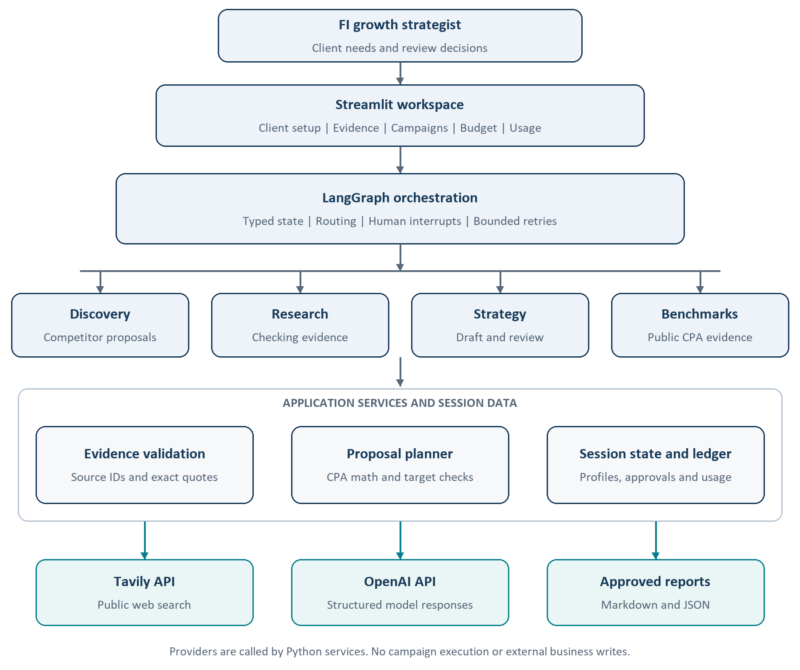
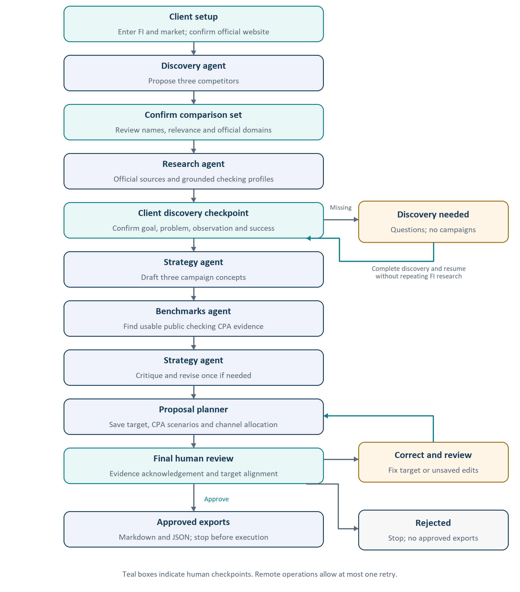

# Bank and Credit Union Growth Intelligence Agent

Project documentation

## Part 1 Use case

The Bank and Credit Union Growth Intelligence Agent helps FI growth and marketing strategists prepare checking acquisition proposals by researching competitors, developing campaign concepts and calculating an editable budget in Streamlit, with human confirmation and final approval.

Built with Python, LangGraph, OpenAI, Tavily and Streamlit. Data comes from live public web research, strategist entered discovery information and curated recorded demo evidence.

### Problem statement

Strategists currently spend 1 to 2 days reviewing materials and preparing a proposal. Researching products, comparing competitors and translating client goals into campaign options and costs often span separate searches and spreadsheets. The application brings those steps together while exposing evidence gaps and planning assumptions.

### Scope

The current scope is consumer checking, one product per institution, with direct mail, display and paid social campaign options. Outputs include a competitor comparison, strategist takeaway, three campaign concepts, public CPA research, a saved budget scenario and approved Markdown and JSON reports.

Campaign execution, audience activation, CRM updates, historical performance reporting, branch overlap scoring and persistent databases are outside the current implementation. The application does not commit budget or guarantee acquisition results.

### Project access

Application: https://bank-cu-growth-intelligence.streamlit.app/
Code: https://github.com/Chandra-P/bank-cu-growth-agent
Runtime: Python 3.12
Interface: Streamlit
Recorded demo: available without API keys

## Part 2 Agent framework

### Agent statement

My agent helps FI growth strategists research competitors and prepare checking campaign proposals in Streamlit, replacing 1 to 2 days of manual material review and proposal preparation, autonomously researching, analyzing and drafting through two external API tools, Tavily search and OpenAI model inference, handing identity confirmation and final approval to a human, with success targeted as a usable reviewed first proposal in under 60 minutes in at least 8 of 10 cases.

| Framework field | Implementation |
| --- | --- |
| Agent goal | Turn confirmed client needs and competitive evidence into a reviewed checking acquisition proposal. |
| Where people use it | A Streamlit web workspace for internal FI growth and marketing strategists. |
| Steps in order | 1. Confirm FI and competitors. 2. Research and confirm needs. 3. Draft, benchmark and revise. 4. Save budget, review and export. |
| Actions and tools | 1. Website lookup and 2. public research are read only. 3. Extract and validate facts, 4. draft and review campaigns and 5. calculate budgets update session content only. 6. Export creates a downloadable report after approval; no external business record is changed. |
| Memory | Institutions, sources, profiles, discovery, drafts, budgets, approval and usage live in session memory. Client changes reset analysis; there is no persistent cross session database. |
| Hard limits | Never invent facts, expose credentials, commit spend or launch campaigns. Keep unknown terms unverified and CPA assumptions labeled. |
| Human in the loop | Confirm the domain, competitors and client discovery; correct inputs as needed. Acknowledge evidence and target alignment before final approval and export. |
| Failure handling | Retry remote calls once; offer manual website correction and explicit evidence gaps. Preserve grounded facts after a failed follow up and return invalid approvals for correction. |
| Success measure | At least 8 of 10 distinct FI cases yield a strategist accepted first proposal in under 60 elapsed minutes; this is an evaluation target, not a measured result. |

### Measurable success criterion

Time each case from a complete client brief with working credentials through human review and approved export, including retries and edits; count blocked and failed cases. A passing proposal covers three reviewed competitors, traceable claims or explicit gaps, relevant campaigns, labeled CPA assumptions and an accurate budget aligned with the funded account target, accepted for client discussion with only minor edits.

The 1 to 2 day baseline is a domain estimate, not a timed study. A timed 10 case human strategist evaluation is still required; automated recommendation scores do not establish human acceptance or time savings. The target concerns a first proposal, not final client approval.

## System architecture

A Streamlit workspace connects the strategist to a LangGraph workflow with four specialist agent roles. Python services handle provider calls, evidence checks, proposal calculations and session usage tracking.



The four agents share a configurable model client. LangGraph coordinates state and human interrupts; it is not an additional model agent. Session data is held in memory rather than a persistent customer database.

## Agent workflow

Research and recommendations move through explicit review checkpoints. Incomplete discovery returns questions; invalid proposal inputs return to correction before approval.



## Components data and prompts

| Component | Purpose |
| --- | --- |
| app.py and local_app.py | Public interface and separate loopback local launcher |
| growth/graph.py and models.py | Workflow routing, human interrupts and typed state |
| growth/providers.py and website.py | OpenAI and Tavily operations and website lookup |
| growth/evidence.py and discovery.py | Source grounding and discovery readiness |
| growth/planning.py and report.py | Budget calculation, target alignment and approved exports |
| growth/usage.py | Tool attempts, token usage and estimated cost |
| growth/panels.py and dashboard.py | Streamlit controls and presentation |

### Data model

Each institution profile stores product name, monthly fee, opening deposit, minimum balance, fee waiver, acquisition bonus, eligibility, positioning and recent news. Evidence records contain a source ID, URL, excerpt and supporting quote. Discovery stores the client goal and outcome definition. Proposal state stores the target, CPA scenarios, channel shares, notes and review receipt.

### Evidence rules

A source supported claim must use a collected source on the confirmed domain with an exact normalized quote and matching numeric tokens. Product identity must be supported before product terms can be accepted. Unknown information is not treated as zero or no offer. Supported claims appear first.

Quote matching provides traceability rather than independent factual verification. Source freshness, complete conditions and eligibility require human review. Client reported goals and illustrative inputs remain separate from public evidence.

### Prompt design

The shared system instruction requires structured JSON, treats retrieved content as data, prohibits invented facts and source IDs, preserves product conditions and requires explicit unknowns. Stage specific prompts guide website identity, competitor selection, extraction, campaign drafting, critique and benchmark qualification.

Campaign prompts connect the recommendation to the confirmed client problem and observation. Review checks grounding, channel relevance and unsupported assumptions. An invalid revision retains the original draft with a warning.

## Proposal planning and human review

### Budget scenarios

The planner uses an editable all in checking CPA range of $300 low, $450 base and $600 high. These defaults are strategist planning assumptions, not verified industry benchmarks. Public benchmark candidates retain their source, account definition and cost coverage; they do not automatically replace the scenario inputs.

Budget equals target accounts multiplied by all in CPA. Media, production, data, fees and incentives are included rather than added again. The default mail and display mix is 70 and 30 percent. Including paid social suggests 60 percent mail, 25 percent display and 15 percent social. Shares are editable heuristics, not optimized allocations or predicted acquisition contributions.

| Illustrative scenario | Amount |
| --- | --- |
| Funded checking target | 300 accounts |
| Base all in CPA | $450 |
| Total base budget | $135,000 |
| Direct mail at 60 percent | $81,000 |
| Display at 25 percent | $33,750 |
| Paid social at 15 percent | $20,250 |

### Approval boundaries

Humans confirm the official website and competitor set, complete client discovery and review the final proposal. A structured funded account target prefills the planner. Conflicting targets or an incompatible opened or activated account outcome block approval and export. Unspecified targets require explicit assumption acknowledgement.

Budget shares must total 100 percent and CPA scenarios must be positive and ordered. Exact cent arithmetic keeps channel totals consistent. Unsaved changes invalidate review; saved approved proposals are locked. Approval enables Markdown and JSON downloads only. Drafts remain visible for review.

### Observability

The in app panel reports provider attempts, retries, outcomes, durations, input and output tokens, cache reads and writes, and estimated model cost. Ordinary input, cache reads, cache writes and output are priced once each using a dated rate table. Missing usage or unknown pricing is flagged as incomplete. Tavily credits are reported separately; total provider charges depend on the visitor’s plan.

## Part 3 Selected build track and tools

Selected track: Track 2, code with Python, LangChain and LangGraph. The workflow requires four specialist roles, shared state, conditional routing, bounded retries and human checkpoints. Code provides direct control over these behaviors and allows automated regression checks; the tradeoff is more implementation and maintenance effort.

| Tool | Role and reason for selection |
| --- | --- |
| Python | Implements API services, evidence validation, exact budget calculations and automated tests in one codebase. |
| LangChain integration | langchain openai provides the model client and structured response integration without custom low level model plumbing. |
| LangGraph | Coordinates stateful steps, conditional paths and resumable human interrupts for discovery and final review. |
| OpenAI API | Generates structured extraction, campaign concepts, critique and revision. It is the selected model provider for the implemented workflow. |
| Tavily Search API | Retrieves current public web evidence with source URLs and excerpts, including searches restricted to confirmed official domains. |
| Streamlit | Provides a Python web interface for client inputs, evidence, campaign cards, budget editing and human review. |
| Pydantic | Validates structured model responses and workflow inputs so malformed or incompatible data is rejected. |
| Custom usage ledger | Captures attempts, input and output tokens, cache categories and estimated costs directly in the app without a separate tracing service. |
| Codex | Assisted implementation, debugging, regression tests and documentation; business decisions and review remain with the strategist. |
| GitHub and Streamlit Cloud | GitHub stores the code; Streamlit Cloud hosts the public demonstration with visitor supplied API keys. |

### Implementation boundaries

The application uses OpenAI and Tavily with a custom session usage ledger for tracing and costs. LangGraph state is session scoped, with no persistent cross session database.

The two external API tools in the agent statement refer to search and model inference. Frameworks, validation libraries, the interface and hosting tools support the application rather than representing additional research agents.

## Setup validation and operation

### Setup and run

Use Python 3.12. Create a virtual environment, install requirements.txt and copy .env.example to .env for local use. Set OPENAI_API_KEY and TAVILY_API_KEY; OPENAI_MODEL selects the model.

```powershell
python -m venv .venv
.\.venv\Scripts\python.exe -m pip install -r requirements.txt
.\run.ps1
```

The local launcher verifies a loopback address before loading saved keys. Public deployment runs app.py and requires each visitor’s keys; it does not load local .env or shared environment API keys. Keys stay in session memory for calls and are not intentionally written to reports or logs. Clear keys and session removes active session references. Never commit .env.

### Validation

The application passed 94 automated checks covering evidence, routing, discovery gates, retry behavior, client resets, credential isolation, cost arithmetic, planning, approval and export. A live Frost Bank analysis produced four profiles and three campaign concepts with one accepted revision.

The live sample contained 9 source supported fields out of 36. Two competitor product identities remained unverified, and no qualifying public checking CPA benchmark was found. The run made 15 model and 11 search attempts, using 176,372 input and 24,116 output tokens. Complete estimated model cost was $0.030630605 including cache writes, plus 11 Tavily credits. The client goal and approval were illustrative demo inputs.

### Failure handling

Remote operations allow one retry, with 20 second search and 120 second model timeouts. Reasoning models use low reasoning effort and an 8,000 token completion budget. A failed follow up extraction preserves grounded evidence. Website failures offer retry and manual correction. Live errors never silently switch to recorded outputs. Invalid approval returns to review for correction.

### Current boundary and extensions

The system prepares a reviewed research brief and budget scenario, then stops. It does not independently validate the client diagnosis, guarantee product eligibility or predict campaign results. Future extensions include governed historical benchmarks, internal rate cards, branch overlap analysis, audience planning and measurement reporting.

## Development approach and learnings

Codex assisted Python implementation, debugging, automated tests and documentation. Development prompts specified the intended behavior and review boundaries; test results, source evidence and visual checks were used to assess the implementation.

### Coding prompts

Representative prompts used during development are summarized below for clarity. They are implementation objectives rather than runtime system instructions.

| Prompt focus | Development instruction |
| --- | --- |
| Agent orchestration | Build the four agent workflow with review and revision, and add an in app panel for tool calls, input and output tokens, and costs. |
| Website discovery | Fix website lookup so an abbreviated FI name such as united heritage cu can find the official domain reliably, with a clear retry option when lookup fails. |
| Credential handling | Use saved API keys automatically in the local app while keeping the public app bring your own keys. |
| Evidence presentation | Sort verified claims to appear at the top of the evidence view. |

### Implementation iterations

The initial checking comparison was extended with a client discovery checkpoint so campaign recommendations depend on an identified need. Four specialist roles and a bounded critique and revision step added structure to the research and recommendations.

Website recovery, manual correction and client state resets improved handling of lookup failures and client changes. The proposal planner added editable CPA assumptions and channel shares, followed by target alignment checks across the budget, approval and exports. Usage tracking was refined to include cache writes and billable retry attempts.

### Learnings and observations

Competitive research supports a client conversation but does not establish the cause of a growth problem. Separating public facts, client observations and planning assumptions prevents product terms from becoming unsupported diagnoses.

Explicit unknowns are more useful than an apparently complete comparison built from weak evidence. Exact quotes improve traceability, while source conditions and freshness still require human review.

Reliable proposals require consistent state as well as useful model responses. Client resets, saved budget versions and approval checks prevent stale inputs or mismatched targets from reaching exports. Cost visibility also requires capturing usage before parsing failures and pricing cache categories without double counting.

Automated checks and a live rehearsal validate the workflow, not business impact. A strategist evaluation across multiple FI cases is still needed to establish proposal usefulness and preparation time savings.

## Scored recommendation evaluation

Ten fixed FI cases spanning awareness, application completion, funding and activation used synthetic client briefs and fresh public research. A separate, chronology blinded model invocation scored draft and final recommendation sets on goal fit, evidence fidelity, channel fit, testability, measurement and safeguards.

Final automated rubric passes: 10/10; mean score 91.67/100 versus draft mean 75.41/100. Of 10 scored pairs, 9 improved and 0 declined. Passing requires at least 75/100, every dimension at least 2/4, valid citations and channels, and no judge flagged critical issue.

| Institution | Draft /100 | Final /100 | Rubric pass |
| --- | --- | --- | --- |
| Frost Bank | 83.33 | 95.83 | Yes |
| United Heritage CU | 70.83 | 91.67 | Yes |
| Truliant FCU | 83.33 | 91.67 | Yes |
| BECU | 79.17 | 95.83 | Yes |
| Digital Federal CU | 75.0 | 75.0 | Yes |
| Alliant CU | 70.83 | 91.67 | Yes |
| Huntington Bank | 70.83 | 95.83 | Yes |
| Regions Bank | 66.67 | 79.17 | Yes |
| Fifth Third Bank | 70.83 | 100.0 | Yes |
| PNC | 83.33 | 100.0 | Yes |

### Configuration and reliability

Quality scoring used 120 seconds, 8,000 completion tokens and low reasoning effort, now adopted by the application. The earlier 35 second / 3,800 token baseline yielded scored recommendations in 2/10 cases. A fresh post-fix United Heritage production run passed in 127.5 seconds, scoring 91.67/100. A full ten-case end-to-end rerun remains pending; component scores are not a production reliability pass.

### Findings and limits

The judge generally favored goal alignment, grounded claims and safeguards; recurring gaps were similar concepts across channels, unverified audience access and operational details. The same model family generated and judged outputs, so scores may be optimistic. Human strategist acceptance, time savings and campaign lift remain unmeasured. Complete cases, rubric, reasons and results are retained in evals/.

Evaluation date: October 26 2026. All client goals are illustrative, not actual FI performance or campaign authorization.
